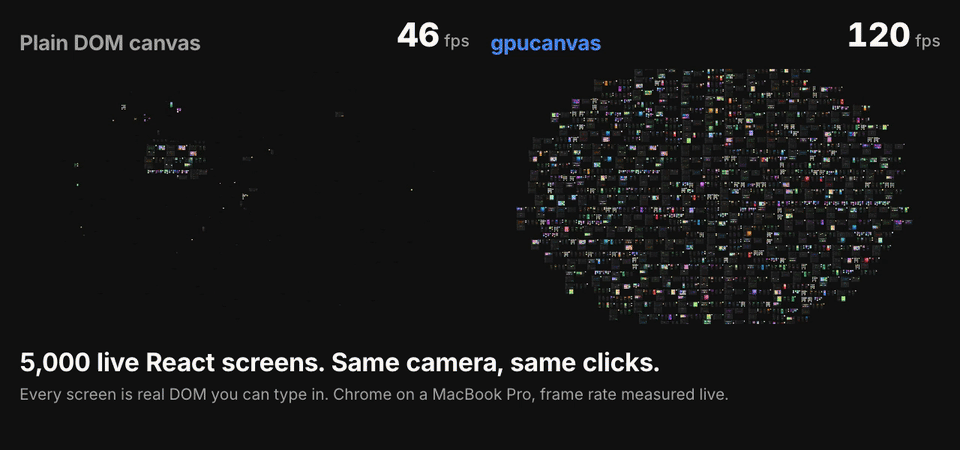

# gpucanvas

Put thousands of live DOM nodes on an infinite canvas: the GPU draws them, an editor selects,
moves and resizes them, and shaders run on them.



The same session on both sides: 5,000 live React screens, the same camera path, a message typed and sent. Left, every screen is plain DOM under a CSS transform. Right, gpucanvas. Recorded in Chrome on a MacBook Pro; the frame rates are measured live in each run. Run it yourself in the [live demo](https://berkantay.github.io/gpucanvas/).

- **[Canvas](#how-it-works).** Live React or plain DOM nodes, drawn by WebGPU in one instanced
  pass. Pan and zoom never touch the DOM, and clicks, typing and state still reach the real
  elements.
- **[Editor](#editing).** Click to select, double-click to go a layer deeper, down to any element
  or React component. Move and resize with snapping guides.
- **[Shader effects](#shader-effects).** Run WGSL on live components: a glass lens, frost,
  shockwaves, glitch, VHS, or your own.
- **[Snapshots](#snapshots).** Any node as an image, pixel diffs between versions, and a
  filmstrip of its history.
- **[Agent view](#agent-view).** What is on the canvas as a short JSON tree with ids, and an
  image of any region, for an AI agent to read and point at.
- **[Transitions](#transitions).** Dissolve, wipe or fade a node out and another in, on the
  GPU, while both stay live.
- **[Marks](#marks).** Arrows between elements, comment pins, notes and live cursors that
  follow the camera.

## Try it

Open **[berkantay.github.io/gpucanvas](https://berkantay.github.io/gpucanvas/)** in Chrome 157 or
later. Thirty agent cursors build the first view, then the camera pulls out to all 5,000 screens.

- Click a screen to select it, double-click to go deeper, drag to move it.
- Pick a shader effect in the toolbar, or open one directly:
  [glass](https://berkantay.github.io/gpucanvas/?effect=glass),
  [shockwave](https://berkantay.github.io/gpucanvas/?effect=shockwave) (click anywhere),
  [frost](https://berkantay.github.io/gpucanvas/?effect=frost),
  [glitch](https://berkantay.github.io/gpucanvas/?effect=glitch).
- Press `b` to run the benchmark tour.

The GPU path needs HTML-in-Canvas, which is behind a flag:

1. Open `chrome://flags/#canvas-draw-element`
2. Set it to Enabled and relaunch Chrome
3. Reload the demo

Without the flag the demo runs the DOM fallback with 1,000 screens and says so.

Status: early (0.3). The API can still change.

```sh
npm install gpucanvas
```

```tsx
import { GpuCanvas, CanvasNode } from 'gpucanvas/react';

<GpuCanvas style={{ width: '100vw', height: '100vh' }}>
  {cards.map((card) => (
    <CanvasNode key={card.id} x={card.x} y={card.y} width={240} height={150}>
      <Card {...card} />
    </CanvasNode>
  ))}
</GpuCanvas>;
```

Nodes stay real DOM: React state, events, CSS and accessibility work as usual. Where WebGPU and
HTML-in-Canvas are available (Chrome 157+), nodes are snapshotted into a GPU atlas and drawn in
one instanced draw call. Everywhere else it falls back to a CSS-transformed container with the
same API.

## Editing

`bindEditor` turns the canvas into an editor: select, drill in, move and resize. The GPU draws
the outlines, 2 CSS pixels wide at any zoom, and they follow their element's layout. Names,
sizes, handles and snapping guides sit in a thin overlay above it.

```ts
import { bindEditor } from 'gpucanvas';

const editor = bindEditor(canvas, {
  pick: 'element', // 'node' (default), 'element', or a function
  trigger: 'click', // an edit mode; the default 'shift-click' leaves clicks to your components
  onChange: (layers) => console.log(layers),
  onTransform: ({ phase, layers, to }) => {
    // The editor never moves anything itself. Apply `to` with updateNode, state or styles.
  },
});
```

A click selects the outermost layer under the pointer, a whole node. Each double-click goes one
layer deeper, and later clicks stay at that depth. Wrappers the size of their parent are skipped,
so every double-click visibly changes something.

| Input              | Does                                                                         |
| ------------------ | ---------------------------------------------------------------------------- |
| Double-click       | One layer deeper                                                             |
| Enter, Shift+Enter | First child, parent                                                          |
| Tab, Shift+Tab     | Next and previous sibling                                                    |
| Escape             | Cancels a drag, then goes up a layer, then clears                            |
| Drag               | Moves, snapping to the edges and centers of neighbors (Shift locks the axis) |
| Handles            | Resize (Shift on a corner keeps the ratio)                                   |
| Drag on open space | A box that selects the layers it touches, inside the layer you are in        |

With the default `trigger: 'shift-click'`, the same works with Shift held, and clicks still reach
your components. A layer is an array of elements, so one layer can be a component that renders
several. `pick` decides the layers:

- `'node'`: whole nodes only.
- `'element'`: every element from the node down to the one under the pointer.
- a function of that element, returning the layers that hold it, outermost first.

In React, `useEditor` gives the selection as state, and `pickComponents` makes the layers React
components:

```tsx
import { labelComponent, pickComponents, useEditor } from 'gpucanvas/react';

// Inside <GpuCanvas>:
const { selected, clear } = useEditor({ pick: pickComponents, label: labelComponent });
// Click a screen, double-click: SignIn, SignInCard, Button.
```

`pickComponents` and `componentOf` read React's internal fibers, as click-to-component tools do.
Production builds usually minify component names, so mark components with your own attributes
when you need names there.

The building blocks, for your own interactions:

```ts
canvas.getElementAt(point); // deepest element at a world point
canvas.getElementRect(el); // any element's rect in world units
canvas.getNodeOf(el); // the node that holds it
canvas.getNodesIn(rect); // nodes overlapping a world rect
canvas.setSelection(elements); // outline these; [] clears
canvas.setHover(el); // a lighter outline; null clears
canvas.screenToWorld(point); // surface pixels to world units, and worldToScreen back
```

Colors are the `selectionColor` and `hoverColor` options. The demo picks React components in the edit mode;
`?pick=element` or `?pick=node` picks elements or whole screens, and `?edit=0` leaves clicks to
the components.

## Shader effects

Components stay live DOM, and the GPU draws them through a shader. One call per node:

```ts
import { effects } from 'gpucanvas';

canvas.setEffect(node, effects.ripple); // the effect's default parameters
canvas.setEffect(node, effects.glow, [1, 0.4, 0.2, 32]); // orange, 32 px reach
canvas.setEffect(node, null); // back to plain
```

Built in:

- Following the pointer: `glass` (a magnifying lens), `frost` (ice, clear around the pointer),
  `dither` (a lens of big dithered pixels).
- On each press: `shockwave`, a ring that bends the node as it spreads.
- Running on their own: `glitch`, `vhs`, `glow`, `hue`, `ripple`.
- Still: `blur`, `pixelate`, `grayscale`, and `dissolve` for a node leaving or arriving (its
  parameter is the progress, 0 to 1).

Animated effects draw every frame while their node is in view; still ones cost nothing once
drawn.

Your own is a WGSL function over the node's pixels:

```ts
import { defineEffect } from 'gpucanvas';

const scanlines = defineEffect({
  name: 'scanlines',
  animated: true,
  params: [3], // line spacing in CSS pixels
  wgsl: /* wgsl */ `
    fn effect(input: EffectInput) -> vec4f {
      let color = source(input.uv);
      let y = input.uv.y * input.size.y + input.time * 20.0;
      return color * (0.85 + 0.15 * step(0.5, fract(y / input.params.x)));
    }`,
});
```

`EffectInput` has `uv` (0 to 1 across the node), `size` in CSS pixels, `time` in seconds,
`zoom`, the four `params`, the `pointer` and the last `press` in the node's uv, and
`sincePress` in seconds. `source(uv)` reads the node's pixels, premultiplied, and is
transparent outside it; `hash` and `noise` give random values. An effect that draws past its
node, like a glow, declares how far with `pad`. Effects read the node's whole snapshot, so very
close in they are softer than plain nodes. In React, `<CanvasNode effect={effects.glass}>` does
the same.

The DOM backend shows effects that have a `css` look as a CSS `filter` (animated ones as filter
animations) and the rest as plain nodes. The demo's toolbar puts one effect on every component.

## Snapshots

Every node is already drawn by the GPU, so its pixels are one call away, with no headless
browser:

```ts
import { diffImages, recordFilmstrip, toBlob } from 'gpucanvas';

const before = await canvas.snapshot(node, { scale: 2 }); // ImageData, drawn fresh
const png = await toBlob(before); // a PNG Blob

// ...the screen changes...
const after = await canvas.snapshot(node, { scale: 2 });
const { changed, bounds, image } = diffImages(before, after); // what moved, and where

// A snapshot after every change, once it settles.
const strip = recordFilmstrip(canvas, node, { scale: 0.25, max: 30 });
strip.frames; // [{ at, image }, ...]
strip.stop();
```

A snapshot is the node as it looks now, at any scale, whether or not it is in view. It takes a
paint or two, about 40 ms for a 1,500 by 1,000 pixel screen. In the demo, select a screen and
press `S` to save it. Snapshots need the GPU backend; the DOM backend rejects.

## Agent view

An agent reads the canvas the way a person sees it: what is there, what it says, and where:

```ts
import { createAgentView } from 'gpucanvas';

const view = createAgentView(canvas);
view.describe(); // what is in view, as JSON
// [{ id: 'e35', tag: 'div', rect: { x: -3552, y: -2561, width: 1496, height: 958 }, children: [
//   { id: 'e6', tag: 'h1', role: 'heading', text: 'Welcome back', rect: { ... } },
//   { id: 'e18', tag: 'input', role: 'textbox', name: 'Email', rect: { ... } },
//   { id: 'e23', tag: 'input', role: 'checkbox', name: 'Keep me signed in', checked: true, ... },
//   { id: 'e25', tag: 'button', role: 'button', text: 'Sign in', rect: { ... } }, ...] }]

view.element('e25'); // the element behind an id
await view.capture('e6', { scale: 2 }); // ImageData of that element
await view.capture({ x: 0, y: 0, width: 4000, height: 3000 }, { scale: 0.25 }); // any region
```

Wrappers that add nothing are left out, so a sign-in screen is about 35 entries and 3.5 KB of
JSON, read in 3 ms. Pass `rect` to read another region and `name` to label elements with your
own names, such as their React component's. `capture` needs the GPU backend.

## Transitions

Any effect whose first parameter is progress (0 whole, 1 gone) animates as a transition:
`dissolve`, `wipe` and `fade` are built in.

```ts
import { animateEffect, effects, swapNodes } from 'gpucanvas';

await animateEffect(canvas, node, effects.wipe, { duration: 600, params: [90] }); // wipe downward
await animateEffect(canvas, node, effects.wipe, { from: 1, to: 0 }); // and back

// One screen burns away while the next appears in its place.
await swapNodes(canvas, oldScreen, newScreen, { effect: effects.dissolve, duration: 800 });
canvas.removeNode(oldScreen);
```

A node that ends whole loses the effect; one that ends gone stays hidden until it is removed.
Starting another animation on a node replaces the running one, which resolves `false`. In the
demo, select a screen and press `D` to dissolve it or `W` to wipe it. The DOM backend fades.

## Marks

Draw on top of the nodes. Marks follow the camera and the elements they are attached to, and
stay the same size on screen at any zoom:

```ts
import { createMarks } from 'gpucanvas';

const marks = createMarks(canvas);
marks.connect(button, nextScreen, { label: 'goes to' }); // a curved arrow
marks.pin(card, { label: '3', text: 'Rename to Continue?', onClick: openThread });
marks.note(view.element('e6'), 'This heading is 2px off the grid'); // what an agent means
const cursor = marks.cursor('Ada', { color: '#e11d48' });
cursor.move({ x: 120, y: 80 }); // glides there, in world units
marks.clear();
```

Arrows and pins also take a world point in place of an element. Marks are SVG and HTML in a
layer above the canvas, so they work with both backends. In the demo, both are on `window`:
`agentView` and `marks`.

## Run the demo

```sh
bun install
bun run dev        # http://localhost:5199/?mode=gpu&n=10000  (mode: auto | gpu | dom)
```

## Releases

Publishing a GitHub release for a `vX.Y.Z` tag that matches `package.json` publishes the package
to npm from GitHub Actions, with provenance, through npm trusted publishing. See
[release.yml](.github/workflows/release.yml).

## How it works

1. **Pages.** Nodes are live DOM inside `<canvas content="drawable">`, packed side by side into
   pages of 2048 CSS pixels. Chrome records a page as one snapshot, so one
   `drawElementImageToTexture` call rasterizes dozens of nodes at once.
2. **Rasterize, then park.** A page with nodes waiting for pixels becomes `drawable`. In the next
   paint event it is drawn into a texture-array atlas, whole or one node at a time when only a
   few changed. Then it is parked with `content-visibility: hidden`, which keeps layout but skips
   paint, so the browser spends nothing on it per frame.
3. **Thumbnails first.** Every node gets a 1/16 scale thumbnail in an atlas layer that is never
   evicted, so a zoomed-out view of thousands of screens is always filled in. Sharper snapshots
   go on top at power-of-two scales, so zooming reuses them.
4. **Tiles up close.** Past 100% zoom on a 2x display, only the visible part of a node is
   rasterized, as sharp tiles, center first. While its content animates, one half-resolution preview stands in.
5. **One draw call.** Each frame culls nodes against the view and draws every visible one with
   one instanced quad draw, or one per run of nodes sharing a shader effect. Panning and zooming
   never touch the DOM. Raster work has a
   per-frame budget, so the camera stays smooth while pixels fill in.
6. **Live updates.** A MutationObserver marks a node dirty when its content changes, and
   loading images, web fonts and CSS transitions trigger a redraw. Animated content on nodes
   under 200 screen pixels refreshes at most four times a second.
7. **Input.** Only the page under the pointer is registered for hit testing, and a CSS transform
   puts the node under the pointer exactly where the GPU drew it. Clicks, typing, selection and
   hover all go to the real element. A focused node keeps its page live.

## Measured (M-series Mac, Chrome 157, 1600 x 900 window, DPR 1)

The demo's benchmark (press `b`) runs a 30-second tour: a message typed and sent, a chart
animating, a push to 500% zoom, shift-click picks and a selection sweep, while 30 agent cursors
build screens around the view. Every frame is timed. At 5,000 screens it measures 113 to 115 fps
for gpucanvas and 18 to 20 for DOM.

The table below was measured with the 0.1 benchmark, a 94-second session from the overview into
clusters of app screens, close-ups up to 500% zoom, 20 clicks and typed messages, then back out.

| Screens | gpucanvas avg fps | gpucanvas p95 | DOM avg fps | DOM p95  | Mount gpucanvas / DOM |
| ------- | ----------------- | ------------- | ----------- | -------- | --------------------- |
| 5,000   | 117               | 9.2 ms        | 23          | 50.2 ms  | 1.2 s / 1.3 s         |
| 10,000  | 108               | 16.7 ms       | 9           | 133.8 ms | 1.8 s / 3.4 s         |

DOM is the same screens in one CSS-transformed container, which is also the fallback backend.

## Chrome 157 findings (differ from the WICG explainer)

- **Hit-test registration.** A drawable is hit-tested only after
  `canvas.updateElementGeometry(el, {})` registers it. The `canvasTransform` option does not
  move the hit area.
- **Hit-test position.** The hit area is the element's CSS box, so position it with
  `el.style.transform = canvas.getElementTransform(el, drawMatrix)`. The draw matrix maps the
  element's default-size snapshot (CSS px × DPR) to canvas pixels.
- **Transform changes.** Changing a drawable's CSS transform or pointer-events reports it in
  `changedElements`.
- **Newly drawable elements.** An element that just became drawable is not reported in
  `changedElements`. Its snapshot is available from the next paint event.
- **Per-call cost.** Each `drawElementImageToTexture` call allocates and fully rasterizes, about
  250 to 550 calls per second in total. This, not compositing, limits the fill rate, which is
  why nodes are batched into pages.
- **Cropping.** A source rectangle still rasterizes the whole source element at the requested
  scale before cropping. Zoomed in, a node therefore moves to a page of its own.
- **Drawable count.** Recording cost scales with the number of drawables (and non-`display:none`
  canvas children) on every `requestPaint`. 10,000 always-drawable nodes run at 22 fps even when
  idle.

## Next

- **Keyboard and accessibility.** Parked pages use `content-visibility: hidden`, so Tab skips
  their nodes. A focused node already stays live; moving focus across pages needs a focus model.
- **Workers.** Composite in a worker with `captureElementImage`, and drive culling from the GPU.
